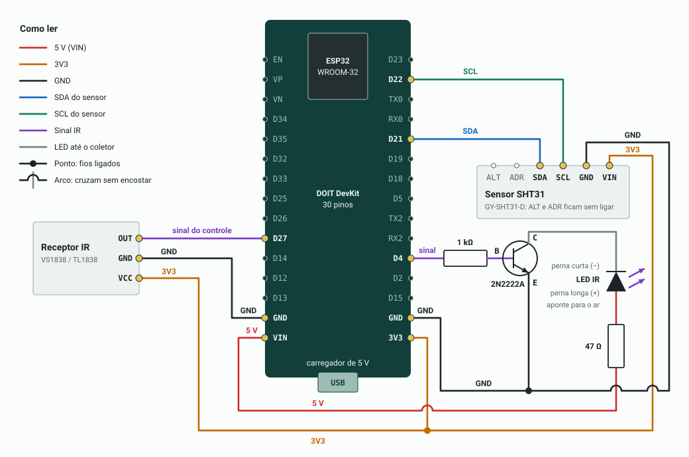
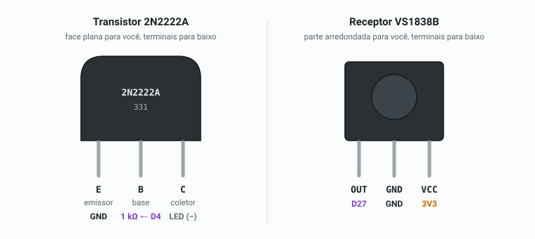

# Ar-condicionado por infravermelho para Home Assistant

Controla um ar-condicionado sem conectividade usando um ESP32 com ESPHome. O ar aparece no Home Assistant como
uma entidade `climate`, com modo, temperatura e ventilação. Um sensor ligado ao ESP32 mede a temperatura e a humidade
do cômodo.

## Peças

- ESP32 DevKit
- LED IR de 940 nm (TSAL6200 ou similar)
- Transistor NPN 2N2222
- Resistores de 1 kΩ e 47 Ω
- Receptor IR de 38 kHz (TSOP38238 ou VS1838B)
- Sensor de temperatura e humidade SHT31 em plaquinha (veja as [alternativas](#sensor-de-temperatura-e-humidade))

## Ligações



```
Emissor
  GPIO4 ── 1 kΩ ── base do 2N2222
  5V (VIN) ── 47 Ω ── LED IR (+)
  LED IR (−) ── coletor do 2N2222
  emissor do 2N2222 ── GND

Receptor
  VCC ── 3V3 (não use 5 V: a saída vai direto no GPIO)
  GND ── GND
  OUT ── GPIO27

Sensor SHT31
  VCC ── 3V3
  GND ── GND
  SDA ── GPIO21
  SCL ── GPIO22
```

### Pinagem dos componentes



O VS1838B segue a ordem do datasheet. No 2N2222A em encapsulamento TO-92, a ordem E, B, C é a mais comum, mas alguns
fabricantes usam C, B, E, como no P2N2222A. Na dúvida, use o modo hFE do multímetro: a posição que mostrar o maior
valor indica a ordem certa.

## Sensor de temperatura e humidade

O `ar-condicionado.yaml` já inclui o pacote do SHT31, em [`packages/sht31.yaml`](../packages/sht31.yaml). Para usar
outro sensor, copie esse pacote para um arquivo novo, como `packages/sht40.yaml`, troque o bloco `sensor` pelo
exemplo correspondente e aponte a linha `sht31` do `ar-condicionado.yaml` para o arquivo novo.

| Sensor | Precisão | Plataforma no ESPHome | Observação |
|---|---|---|---|
| SHT31 | Boa | `sht3xd` | Melhor opção no geral |
| SHT40 | Boa | `sht4x` | Mais novo, mesma ligação do SHT31 |
| AHT20 | Razoável | `aht10` | Mais barato |
| BME280 | Boa em temperatura | `bme280_i2c` | Também mede pressão. O BMP280 é parecido, mas não mede humidade |
| DHT22 | Razoável | `dht` | Aceita fio mais longo, mas é mais lento e menos confiável com o tempo |

Os sensores I²C usam as mesmas ligações do SHT31. A maioria das plaquinhas já tem resistores de pull-up. Se o sensor
vier sem placa, adicione resistores de 4,7 kΩ do SDA e do SCL para 3V3.

SHT40:

```yaml
sensor:
  - platform: sht4x
    temperature:
      name: Temperatura
      id: temperatura_ambiente
    humidity:
      name: Humidade
    update_interval: 60s
```

AHT20:

```yaml
sensor:
  - platform: aht10
    variant: AHT20
    temperature:
      name: Temperatura
      id: temperatura_ambiente
    humidity:
      name: Humidade
    update_interval: 60s
```

BME280 (algumas plaquinhas usam o endereço `0x77`):

```yaml
sensor:
  - platform: bme280_i2c
    address: 0x76
    temperature:
      name: Temperatura
      id: temperatura_ambiente
    humidity:
      name: Humidade
    update_interval: 60s
```

O DHT22 não usa I²C. Apague o bloco `i2c` do pacote novo e ligue VCC em 3V3, GND em GND e o pino de dados no
GPIO25. Se o sensor vier sem placa, adicione um resistor de 4,7 kΩ entre o pino de dados e 3V3.

```yaml
sensor:
  - platform: dht
    pin: GPIO25
    model: DHT22
    temperature:
      name: Temperatura
      id: temperatura_ambiente
    humidity:
      name: Humidade
    update_interval: 60s
```

A posição do sensor afeta a leitura:

- Mantenha o sensor a alguns centímetros do ESP32, porque o calor da placa pode aumentar a temperatura medida.
- Deixe o sensor fora do vento da saída de ar, ou ele vai medir o ar frio em vez da temperatura do cômodo.
- Use até cerca de 50 cm de fio nos sensores I²C. Se precisar de mais distância, use o DHT22.

## Primeira gravação

Prepare o ambiente e o `secrets.yaml` como descrito no [README](../README.md#preparar-o-ambiente). Depois, na raiz do
repositório, grave a placa:

```sh
.venv/bin/esphome run ar-condicionado.yaml
```

Com a placa no USB, escolha a porta serial. As próximas gravações podem ser feitas pelo Wi-Fi.

## Descobrir o protocolo

1. Adicione `dump: all` ao bloco `remote_receiver` em `packages/ir.yaml` e grave de novo. Assim, o log mostra os
   códigos que o receptor capta.
2. Com o log aberto (`.venv/bin/esphome logs ar-condicionado.yaml`), aponte o controle para o receptor e aperte
   alguns botões. Mantenha o celular longe do receptor, porque os sensores da câmera emitem pulsos infravermelhos que
   atrapalham a leitura.
3. Procure a linha com o nome do protocolo, como `Received Coolix: ...`. Ignore linhas como `Received JVC` ou
   `Received Pronto` que aparecem junto com outra: alguns decodificadores aceitam quase qualquer sinal.
4. Altere `ac_platform` no `ar-condicionado.yaml` para a
   [plataforma correspondente](https://esphome.io/components/climate/climate_ir/) e grave de novo. Algumas plataformas
   pedem opções extras, como `model` na `gree`.
5. Teste ligar, desligar e mudar a temperatura. Depois, remova o `dump: all`.

Se o log mostrar só códigos brutos (`Received Raw`), o protocolo não foi reconhecido. Tente a plataforma da marca
ou a [`heatpumpir`](https://esphome.io/components/climate/climate_ir/#heatpumpir). Se nenhuma funcionar, os
códigos brutos capturados podem ser enviados como botões.

### Controles Mirage

O ESPHome reconhece o protocolo Mirage (`Received Mirage: 56:...`), mas não tem uma plataforma `climate` para ele.
Este repositório inclui uma em [`components/mirage`](../components/mirage), que o `ar-condicionado.yaml` carrega
com `external_components`. Ela foi feita para o controle do Super Split SS009, que segue o modelo KKG9AC1 do
protocolo, e também atualiza o Home Assistant quando o controle original é usado.

| Home Assistant | No controle |
|---|---|
| Modos `cool`, `heat`, `dry`, `fan_only` e `heat_cool` | Frio, aquecer, desumidificar, ventilar e automático |
| Ventilação `auto`, `low`, `medium` e `high` | Automática, baixa, média e alta |
| Swing `vertical` | Aleta em movimento |
| Swing `off` | Aleta parada na última posição escolhida no controle original |

No modo desumidificar, o controle sempre envia 17 °C, e a plataforma faz o mesmo.

Os aparelhos já testados e o mapa de bytes do protocolo estão em [modelos.md](modelos.md).

## Home Assistant

Nos exemplos abaixo, `climate.ar_condicionado` é o ID esperado da entidade. Confira o seu em **Configurações →
Dispositivos e serviços → ESPHome → Ar-condicionado**. Os demais IDs (`sensor.*`, `binary_sensor.*`) são exemplos e
precisam ser trocados pelos seus.

### Adicionar o dispositivo

1. Em **Configurações → Dispositivos e serviços**, o dispositivo deve aparecer como descoberto. Clique em
   **Adicionar**.
2. Se ele não aparecer, vá em **Adicionar integração → ESPHome** e informe `ar-condicionado.local` ou o IP do ESP32,
   com a porta `6053`.
3. Informe o `api_key` do `secrets.yaml` quando for solicitado.

Se o Home Assistant estiver em outra VLAN ou sub-rede, a descoberta por mDNS pode não funcionar. Nesse caso, use o IP
e reserve um endereço fixo para o ESP32 no roteador.

### Testar os comandos

Em **Ferramentas de desenvolvedor → Ações**, execute cada ação no modo YAML e confira a resposta do ar:

```yaml
action: climate.set_hvac_mode
target:
  entity_id: climate.ar_condicionado
data:
  hvac_mode: cool
```

```yaml
action: climate.set_temperature
target:
  entity_id: climate.ar_condicionado
data:
  temperature: 23
```

```yaml
action: climate.turn_off
target:
  entity_id: climate.ar_condicionado
```

### Adicionar ao painel

No painel, clique em **Editar → Adicionar cartão → Por entidade** e escolha o ar-condicionado. Pelo editor YAML:

```yaml
type: thermostat
entity: climate.ar_condicionado
```

### Mostrar a temperatura ambiente

A temperatura do sensor ligado ao ESP32 aparece como temperatura atual na entidade `climate`. A temperatura e a
humidade também aparecem como entidades próprias do dispositivo.

Para usar um sensor que já exista no Home Assistant, sem ligar nenhum ao ESP32, remova a linha `sht31` de
`ar-condicionado.yaml` e adicione este bloco ao final do arquivo:

```yaml
sensor:
  - platform: homeassistant
    id: temperatura_ambiente
    entity_id: sensor.sala_temperatura
```

Grave o firmware de novo depois da alteração. O sensor precisa estar no mesmo cômodo do ar, longe da saída de ar.

### Confirmar se o ar está ligado

O estado da entidade `climate` é presumido. Se houver um medidor de potência no circuito do ar, dá para criar um
sensor com o estado real em `configuration.yaml`:

```yaml
template:
  - binary_sensor:
      - name: "Ar-condicionado em funcionamento"
        device_class: running
        state: "{{ states('sensor.medidor_ar_potencia_ativa_total') | float(0) > 100 }}"
        availability: "{{ has_value('sensor.medidor_ar_potencia_ativa_total') }}"
        delay_off: "00:05:00"
```

Ajuste os `100` W olhando o consumo do seu aparelho com o ar ligado e desligado. O `delay_off` evita que o sensor
desligue nas paradas curtas do compressor. Se o aparelho desliga o compressor ao atingir a temperatura, aumente esse
tempo ou reduza o limite para acima do consumo em espera. Depois de editar o arquivo, recarregue em **Ferramentas de
desenvolvedor → YAML → Entidades de template**.

### Automações

Crie em **Configurações → Automações e cenas → Criar automação → ⋮ → Editar em YAML**.

Desligar quando ninguém estiver em casa (usa as pessoas cadastradas com rastreamento de presença):

```yaml
alias: Ar-condicionado - desligar sem ninguém em casa
triggers:
  - trigger: numeric_state
    entity_id: zone.home
    below: 1
    for: "00:15:00"
actions:
  - action: climate.turn_off
    target:
      entity_id: climate.ar_condicionado
mode: single
```

Desligar quando a janela ficar aberta:

```yaml
alias: Ar-condicionado - desligar com janela aberta
triggers:
  - trigger: state
    entity_id: binary_sensor.janela_sala
    to: "on"
    for: "00:02:00"
actions:
  - action: climate.turn_off
    target:
      entity_id: climate.ar_condicionado
mode: single
```

## Solução de problemas

- **O ar não responde:** olhe o LED pela câmera do celular enquanto envia um comando. Ele deve piscar (algumas
  câmeras filtram IR; se não enxergar, teste com outra). Se piscar, aproxime e aponte melhor para o receptor do ar.
- **Nada aparece no log:** confira a alimentação e a pinagem do receptor.
- **O sensor I²C não dá leitura:** procure no log o resultado da busca do I²C (`Found device at address`). Se aparecer
  outro endereço, ajuste `address` no bloco `sensor`. Se aparecer `Found no devices`, confira a alimentação e os fios
  SDA e SCL.
- **O estado no Home Assistant está errado:** o IR não confirma o recebimento, então o estado é presumido. Uso do
  controle original só é captado quando o receptor enxerga o sinal e o protocolo tem suporte a recepção.
