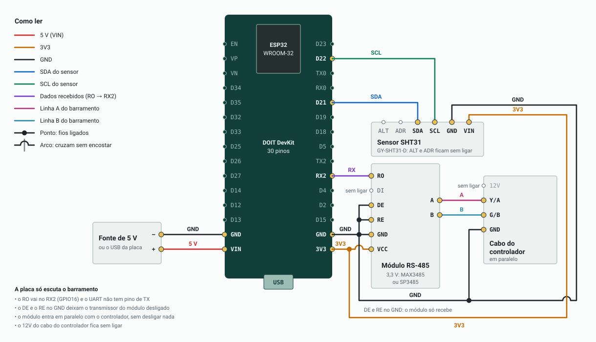
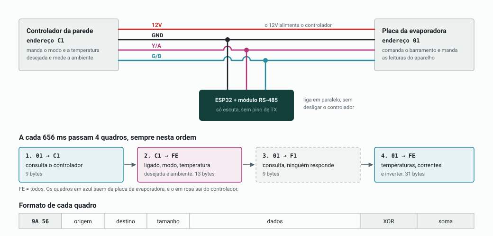

# Ar-condicionado central Carrier Ecosplit pelo barramento do controlador

Lê dois aparelhos centrais Carrier Ecosplit pelo Home Assistant, com um ESP32 ligado no cabo do controlador da
parede. Cada aparelho aparece no Home Assistant com o modo, a temperatura desejada, as temperaturas da unidade
externa, as correntes dos compressores e os dados do inverter. Um sensor ligado ao ESP32 mede a temperatura e a
humidade do cômodo.

> **Em andamento.** As placas só leem o barramento, ainda sem controlar os aparelhos. Elas compilam, mas ainda não
> foram testadas no barramento. O próximo passo é o controle, descrito no [plano](#plano).

Outros documentos deste projeto:

- [protocolo.md](protocolo.md): o mapa dos quadros do barramento
- [captura.md](captura.md): como o protocolo foi descoberto e como capturar o barramento pelo PC

## Peças

Para cada aparelho:

- ESP32 DevKit
- Módulo RS-485 de **3,3 V** com os pinos DE e RE expostos, como os de MAX3485 ou SP3485
- Fonte de 5 V para o ESP32
- Sensor de temperatura e humidade SHT31 em plaquinha (veja as
  [alternativas](../ar-condicionado/README.md#sensor-de-temperatura-e-humidade))

Evite estes módulos RS-485:

- **MAX485 alimentado em 5 V**, o módulo azul mais comum. A saída RO dele fica em 5 V, e o GPIO do ESP32 não aguenta
  5 V.
- **Módulos com direção automática**, que só têm os pinos RX e TX, sem DE e RE. Eles ligam o transmissor sozinhos
  pelo pino TX, e sem esse controle o ESP32 pode acabar mexendo no barramento.

## Ligações



```
Módulo RS-485
  VCC ── 3V3
  GND ── GND do ESP32 e GND do cabo do controlador
  RO ── GPIO16 (RX2)
  DI ── sem ligação
  DE e RE ── GND (o módulo só recebe)
  A ── Y/A do cabo do controlador
  B ── G/B do cabo do controlador

Cabo do controlador
  12V ── sem ligação
  GND ── GND

Sensor SHT31
  VCC ── 3V3
  GND ── GND
  SDA ── GPIO21
  SCL ── GPIO22

Fonte de 5 V
  + ── VIN (ou o USB)
  − ── GND
```

- O módulo entra **em paralelo** com o controlador, sem desligar nenhum fio dele.
- Mexa só no cabo do controlador. A alimentação do aparelho é de 380 V.
- O fio de 12V do cabo do controlador fica sem ligação. Isole a ponta dele enquanto mexe: se ele encostar em A ou B,
  o módulo pode queimar.
- O GND precisa ser comum entre a fonte do ESP32, o módulo e o cabo do controlador. Sem ele, a referência fica solta
  e a leitura falha.
- Muitos módulos têm um resistor de terminação de 120 Ω entre A e B (marcado "121"). O barramento já tem a sua
  terminação, e mais uma pode enfraquecer o sinal entre o controlador e a evaporadora. Com o módulo ligado, meça a
  tensão entre A e B com o aparelho funcionando. Se ela cair abaixo de cerca de 1 V, retire o resistor.
- Em placas com PSRAM (ESP32-WROVER), o GPIO16 é usado pela memória. Nesse caso, escolha outro pino com a
  substituição `ecosplit_rx_pin` no YAML da placa.

### Como a placa usa o barramento



O controlador da parede e a placa da evaporadora conversam pelo cabo em RS-485, a 9600 baud. A cada 656 ms, a
placa da evaporadora consulta o controlador, que responde com o modo e a temperatura desejada, e depois manda para
todos as leituras do aparelho. O ESP32 só escuta essa conversa e publica os valores. O mapa completo está em
[protocolo.md](protocolo.md).

A placa não tem como transmitir, por dois motivos: o UART não tem pino de TX, e o DE e o RE do módulo ficam no GND,
o que deixa o transmissor dele sempre desligado.

## Sensor de temperatura e humidade

As placas `evap-1.yaml` e `evap-2.yaml` incluem o pacote do SHT31, em
[`packages/sht31.yaml`](../../packages/sht31.yaml), o mesmo do ar-condicionado por IR. Para usar outro sensor, siga
as [alternativas](../ar-condicionado/README.md#sensor-de-temperatura-e-humidade) do guia do ar-condicionado.

O controlador da parede também mede a temperatura, e ela aparece como "Temperatura no controlador". O SHT31 mede
onde o ESP32 estiver, então dá para comparar os dois pontos do cômodo. Mantenha o sensor longe do calor da placa e
fora do vento da saída de ar.

## Primeira gravação

Prepare o ambiente e o `secrets.yaml` como descrito no [README](../../README.md#preparar-o-ambiente). Depois, na
raiz do repositório, grave cada placa:

```sh
.venv/bin/esphome run evap-1.yaml
.venv/bin/esphome run evap-2.yaml
```

Com a placa no USB, escolha a porta serial. As próximas gravações podem ser feitas pelo Wi-Fi.

Para conferir a leitura antes de ligar no Home Assistant, olhe o log: `.venv/bin/esphome logs evap-1.yaml`. Em
poucos segundos, os valores devem aparecer sendo publicados.

## Home Assistant

### Adicionar o dispositivo

1. Em **Configurações → Dispositivos e serviços**, cada placa deve aparecer como descoberta. Clique em
   **Adicionar**.
2. Se ela não aparecer, vá em **Adicionar integração → ESPHome** e informe `evap-1.local` (ou `evap-2.local`) ou o
   IP do ESP32, com a porta `6053`.
3. Informe o `api_key` do `secrets.yaml` quando for solicitado.

Os dispositivos aparecem como "Evaporadora 1" e "Evaporadora 2".

### Entidades

| Entidade | De onde vem |
|---|---|
| Ligado, Modo, Temperatura desejada, Temperatura no controlador | Pedidos do controlador da parede |
| Temperatura externa, do condensador, de sucção, de descarga 1 e 2 | Sensores da unidade externa |
| Temperatura do dissipador, Frequência do inverter, Corrente do inverter, Tensão do barramento DC | Inverter |
| Corrente 1, Corrente 2 | Correntes dos compressores. A corrente 2 é do compressor fixo |
| Ventilador da evaporadora | Bit de estado da placa da evaporadora |
| Temperatura, Humidade | Sensor SHT31 da placa |
| Comunicação | Fica desligada quando a placa passa 5 segundos sem receber um quadro válido |

Sem comunicação, os valores do barramento ficam como indisponíveis, em vez de mostrar números velhos.

Em **Diagnóstico** ficam os bytes ainda não identificados, como "Evaporadora byte 21", e os bits do byte 17. Eles
ficam no histórico do Home Assistant para ajudar a descobrir o que são. Cada valor é publicado só quando muda, para
não encher o histórico a cada ciclo de 656 ms.

## Solução de problemas

- **"Comunicação" fica desligada:** confira se A e B estão invertidos, se o GND do módulo está ligado ao GND do cabo
  do controlador e se o RO vai no GPIO16. Para conferir o barramento sem o ESP32, use o
  [monitor ao vivo](captura.md#monitor-ao-vivo) pelo PC.
- **O controlador da parede mostra erro de comunicação depois de ligar o módulo:** solte o módulo. Confira se o DE e
  o RE estão no GND e se o módulo tem o resistor de 120 Ω entre A e B.
- **Os valores do inverter ficam parados:** no primeiro aparelho, a frequência, a corrente e o barramento DC do
  inverter não mudaram durante as capturas, nem com o compressor funcionando. Pode ser um problema no inverter desse
  aparelho, e não na leitura. Veja as [pendências](#pendências).
- **O sensor I²C não dá leitura:** veja a [solução](../ar-condicionado/README.md#solução-de-problemas) no guia do
  ar-condicionado.

## Equipamentos

| Peça | Modelo | Observação |
|---|---|---|
| Unidade externa (condensadora) | 38EVC10386S | 10 TR, 380 V |
| Unidade interna (evaporadora) | 40VX10HHG236V1V | Linha Ecosplit, com resistências de aquecimento |
| Controlador com fio | Não identificado | Cabo de 4 fios: 12V, GND, Y/A e G/B. Controla frio, ventilação e aquecimento |

São dois conjuntos iguais, e cada um tem o seu cabo e o seu controlador. Cada aparelho tem dois compressores: um
inverter (1º estágio) e um fixo (2º estágio). O comando do aparelho trabalha em 12 V: o controlador é alimentado pelo
fio de 12V e as contatoras são de 12 V.

Além da temperatura ambiente, do modo e da temperatura desejada, os controladores mostram a temperatura externa, do
condensador, de sucção e de descarga 1 e 2 e o código de erro da unidade externa. Mesmo com o equipamento igual, cada
controlador mostra leituras extras diferentes:

| Aparelho | Leituras extras no controlador |
|---|---|
| Primeiro | Corrente 1 e corrente 2 |
| Segundo | Frequência do compressor, corrente do compressor, temperatura do dissipador e tensão do barramento DC |

O barramento dos dois leva os mesmos dados, e as placas mostram todos eles.

O [manual do Ecosplit](https://cdn.carrierdobrasil.com.br/downloads_docs/1196f-CT-Ecosplit-Inverter-J-11-14--view-.pdf)
lista a 38EVC10386S como condensadora compatível com as evaporadoras 40VX. Não foi encontrado o esquema de ligação
do controlador.

## Plano

1. **Capturar pelo PC.** Feito. O barramento é RS-485 a 9600 baud, 8N1. Veja [captura.md](captura.md).
2. **Mapear o protocolo.** Quase todo feito: modo, temperaturas, correntes e inverter estão confirmados. Ainda faltam
   o código de erro, a ventilação e alguns bytes. Veja [protocolo.md](protocolo.md).
3. **Ler pelo Home Assistant.** As placas `evap-1` e `evap-2` estão prontas e esperam o módulo RS-485 para o teste no
   barramento.
4. **Controlar.** No RS-485, só um lado pode comandar por vez. Ainda falta escolher entre trocar o controlador pelo
   ESP32 ou enviar comandos sem atrapalhar o controlador. A placa da evaporadora consulta um endereço `F1` que
   ninguém responde. Se ele for a vaga de um segundo controlador, o ESP32 pode responder como `F1` sem brigar com o
   controlador da parede. Isso só pode ser testado transmitindo. Como o barramento é digital, a placa da evaporadora
   continua decidindo quando ligar a resistência e mantém as proteções do aparelho, como não ligar a resistência com
   o ventilador parado.

## Pendências

- Verificar o inverter do primeiro aparelho. Nas capturas, só o compressor fixo funcionou, e a frequência, a corrente
  e o barramento DC do inverter ficaram parados. Ver o código de erro e, se for o caso, chamar um técnico
- Saber o que a corrente 1 mede. A corrente 2 é do compressor fixo, e a do inverter vem em outro byte
- Descobrir o código de erro e os bytes que faltam no [mapa](protocolo.md)
- Fotos do controlador por trás e da régua de bornes da evaporadora, para achar o modelo do controlador e da placa.
  Fotos das chaves DIP das placas dos dois aparelhos ajudam a entender os bytes que mudam de um para o outro
