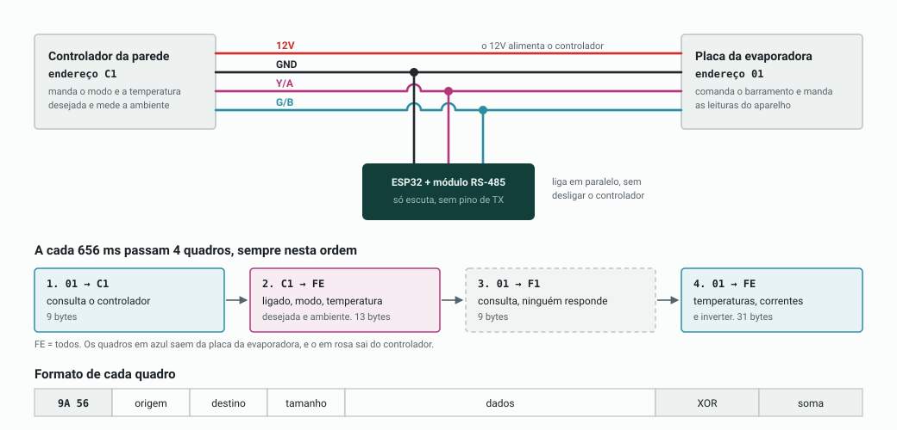

# Protocolo do barramento do Carrier Ecosplit

Mapa parcial, montado a partir de capturas feitas com o
[`tools/captura_rs485.py`](../../tools/captura_rs485.py). O guia do projeto está no
[README](README.md), e o jeito de capturar está em [captura.md](captura.md).

RS-485 a **9600 baud, 8N1**. Os 8.690 quadros capturados seguem o formato abaixo, sem nenhum erro de verificação.

| Byte | Conteúdo |
|---|---|
| 0 e 1 | Início, sempre `9A 56` |
| 2 | Endereço de origem (provável) |
| 3 | Endereço de destino (provável) |
| 4 | Tamanho do quadro inteiro, em bytes |
| 5 até o antepenúltimo | Dados |
| Penúltimo | XOR de todos os bytes anteriores |
| Último | Soma, módulo 256, de todos os bytes anteriores, incluindo o XOR |

## Endereços e ciclo

O barramento repete sempre o mesmo ciclo de 4 quadros a cada 656 ms:

| Ordem | Origem → destino | Tamanho | Conteúdo |
|---|---|---|---|
| 1 | `01` → `C1` | 9 | Consulta, com os dados `FF FF` |
| 2 | `C1` → `FE` | 13 | Resposta do controlador, 35 ms depois |
| 3 | `01` → `F1` | 9 | Consulta, com os dados `FF FF`. Ninguém responde |
| 4 | `01` → `FE` | 31 | Leituras da placa da evaporadora |

- `01`: placa da evaporadora (provável). Ela comanda o barramento.
- `C1`: controlador da parede.
- `F1`: não responde nesta instalação. Pode ser a vaga de um segundo controlador.
- `FE`: todos.

## Quadro do controlador (`C1` → `FE`, 13 bytes)

Exemplo: `9A 56 C1 FE 0D 19 01 01 00 00 03 E4 BE`, com 25 °C desejados, 25,7 °C no ambiente e modo ventilar.

| Byte | Conteúdo | Situação |
|---|---|---|
| 5 | Bit 7 (`80`): ligado. Bits 0 a 6: temperatura desejada em °C. `19` = desligado, 25 °C. `99` = ligado, 25 °C. `94` = ligado, 20 °C. `14` = desligado, 20 °C | Confirmado com 25, 23 e 20 °C, ligado e desligado |
| 6 e 7 | Temperatura ambiente medida no controlador, em décimos de °C, byte mais alto primeiro. `01 01` = 25,7 °C | Confirmado: `01 02` = 25,8 °C, como na tela. A tela atualiza mais devagar que o barramento |
| 8 e 9 | `00 00`, ligado ou desligado. Talvez a ventilação | A descobrir |
| 10 | Modo: `01` frio, `02` aquecer, `03` ventilar. Segue a ordem do botão de modo | Confirmado |

## Quadro da evaporadora (`01` → `FE`, 31 bytes)

Os dois aparelhos usam o mesmo quadro. O byte 5 é `30` no primeiro e `20` no segundo, talvez uma identificação. Exemplo
do primeiro aparelho com o compressor 2 funcionando em frio: `9A 56 01 FE 1F 30 00 4F 54 4E 5B 56 52 13 00 1C 06 0F 00 02 BC 98 5A
00 0C 01 07 00 00 66 A0`.

As temperaturas vêm em °C + 55, um byte cada: `4E` = 78 − 55 = 23 °C. As correntes vêm em passos de 0,25 A. As duas
codificações foram conferidas com os valores da tela no fim de uma captura com o compressor 2 funcionando:

| Tela | Byte | Valor | Conta |
|---|---|---|---|
| Externa 23 °C | 7 | `4E` | 78 − 55 = 23 |
| Condensador 29 °C | 8 | `54` | 84 − 55 = 29 |
| Sucção 21 °C | 9 | `4C` | 76 − 55 = 21 |
| Descarga 1: 42 °C | 10 | `60` | 96 − 55 = 41. A descarga subia 1 °C a cada 7 s |
| Descarga 2: 33 °C | 11 | `58` | 88 − 55 = 33 |
| Corrente 1: 0,0 A | 14 | `00` | 0 × 0,25 = 0,0 |
| Corrente 2: 6,7 A | 15 | `1B` | 27 × 0,25 = 6,75. A tela corta para 6,7 |

| Byte | Comportamento nas capturas | Hipótese |
|---|---|---|
| 7 | `4A` às 8 h, `4F` ao meio-dia | **Confirmado:** temperatura externa, °C + 55 |
| 8 | Subiu de `4F` para `54` com o compressor funcionando | **Confirmado:** condensador, °C + 55 |
| 9 | Desceu de `4F` para `4C` com o compressor funcionando | **Confirmado:** sucção, °C + 55 |
| 10 | Subiu de `50` para `60` com o compressor funcionando | **Confirmado:** descarga 1, °C + 55 |
| 11 | Subiu de `50` para `58` com o compressor funcionando | **Confirmado:** descarga 2, °C + 55 |
| 12 | `51` a `56` (26 a 31 °C) | **Confirmado:** dissipador do inverter, °C + 55. Conferido no mesmo instante com a tela do controlador do outro aparelho |
| 13 | `13` (19) no primeiro aparelho e `23` (35) no segundo, fixo, ligado ou desligado | Não é a externa nem a frequência. Provavelmente configuração |
| 14 | `00` | **Confirmado:** corrente do compressor 1, em passos de 0,25 A |
| 15 | `00` desligado. Pulou para `42` na partida e ficou entre `17` e `1C` | **Confirmado:** corrente do compressor 2, em passos de 0,25 A. Conferido com 7,0 A (`1C`) e 6,7 A (`1B`). O `42` = 16,5 A é o pico da partida, típico do compressor fixo |
| 17 | `00` desligado, `08` ao ligar, `0C` 70 s depois de passar para frio, `0D` e `0F` antes da partida do compressor | Bits de estado. `08` = ventilador da evaporadora. Os outros ainda não se sabe quais são |
| 18 | `00` desligado. No segundo aparelho, subiu de `1F` para `24` com o inverter funcionando. No primeiro, ficou em `00` o tempo todo | **Confirmado no segundo aparelho:** frequência do compressor inverter, em Hz. A tela mostrava cerca de 35 Hz |
| 19 | `02` desligado. No segundo aparelho, entre `14` e `16` com o inverter funcionando. No primeiro, ficou em `02` o tempo todo | **Confirmado no segundo aparelho:** corrente do compressor inverter, em passos de 0,25 A. `16` = 5,5 A, como na tela |
| 20 | No segundo aparelho: `8F` desligado, `84` com o compressor funcionando. No primeiro: `BA` a `C0` o tempo todo, ligado ou desligado | **Confirmado no segundo aparelho:** tensão do barramento DC do inverter, em passos de 4 V. `8F` = 143 × 4 = 572 V e `84` = 132 × 4 = 528 V, contra 572 V e 524 V na tela. No primeiro aparelho, o mesmo cálculo daria ~756 V sem variação, o que não é plausível. A conferir |
| 21 | Subiu de `00` até `9E` em 35 s, depois do bit `04` do byte 17, e ficou entre `96` e `9B`. O mesmo nos dois aparelhos | Não é o inverter. Talvez a velocidade do ventilador da condensadora |
| 22 | `00`, depois `14` 20 s depois de passar para frio, depois `5A`. O mesmo nos dois aparelhos | Desconhecido |
| 23 | `00` desligado e `2E` (46) com o inverter funcionando, no segundo aparelho. `00` o tempo todo no primeiro | Algum dado do inverter |
| 26 | Muda sozinho de 1 em 1, às vezes subindo e às vezes descendo, de `00` a `09` | Desconhecido |

Exemplo do segundo aparelho com os dois compressores funcionando, o inverter a 36 Hz e 5,5 A:
`9A 56 01 FE 1F 20 00 4D 52 4B 5A 57 52 23 00 1C 06 0E 24 16 84 99 5A 2E 0C 01 03 00 00 65 C2`.

No primeiro aparelho, os dados do inverter não mudaram durante as capturas, nem com o compressor funcionando: a
frequência (byte 18) ficou em 0, a corrente (byte 19) em 0,5 A, que é o valor do segundo aparelho desligado, e o
barramento DC (byte 20) em ~756 V. Só o compressor fixo funcionou. Isso pode indicar um problema no inverter desse
aparelho, e talvez explique por que o controlador dele não mostra as leituras do inverter.

Os outros bytes não mudaram em nenhuma captura. Ainda faltam o código de erro e a ventilação. O
[`tools/monitor_ecosplit.py`](../../tools/monitor_ecosplit.py) mostra esses valores ao vivo.
